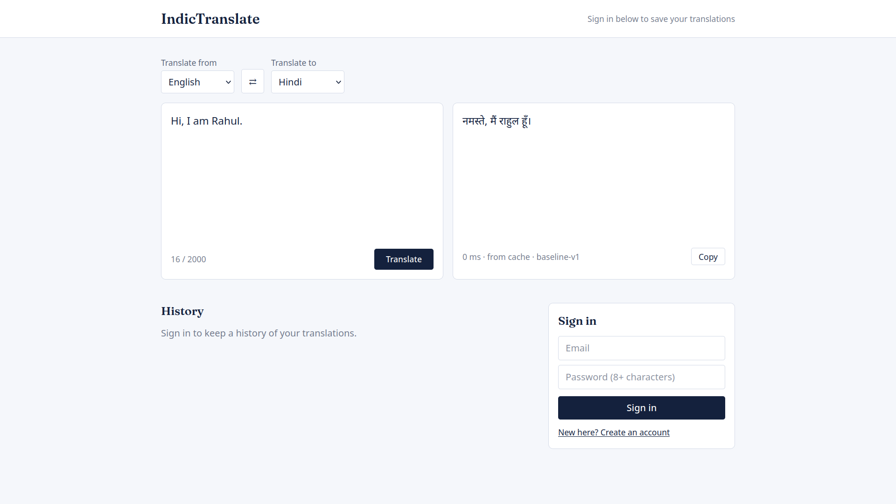

# IndicTranslate 🌐

**An AI-powered translation platform for English and Indian languages.**

IndicTranslate is a multilingual translation web application designed to make communication across Indian languages easier. It combines a React and TypeScript frontend with a FastAPI backend and the IndicTrans2 model to provide translations between English and supported Indian languages.

The platform also includes user authentication, translation history, caching, and an experimental pipeline for evaluating and fine-tuning translation models.

## 📸 Application Preview



## ✨ Features

- **Multilingual Translation:** Translate between English and supported Indian languages.
- **AI-Powered Translation:** Integrates AI4Bharat's IndicTrans2 models for translation.
- **Clean User Interface:** Simple side-by-side translation panels with language selection and a swap option.
- **Translation History:** Sign in to save and revisit previous translations.
- **User Authentication:** Account creation and sign-in functionality.
- **Copy Translations:** Quickly copy translated text.
- **Translation Caching:** Reduce repeated computation and improve response times.
- **Input Validation:** Enforce text-length limits and supported language pairs.
- **REST API:** FastAPI endpoints for translation and language information.
- **ML Experimentation:** Scripts for preprocessing data, evaluating models, and fine-tuning checkpoints.
- **Containerized Deployment:** Docker Compose support for running the application and backend services.

## 🛠️ Tech Stack

| Component | Technology |
|---|---|
| Frontend | React, TypeScript, Vite |
| Backend | Python, FastAPI |
| Translation Model | AI4Bharat IndicTrans2 |
| ML Framework | PyTorch, Hugging Face Transformers |
| Database | SQLite for local development; PostgreSQL support |
| Caching | In-memory cache; Redis support |
| Deployment | Docker, Docker Compose |
| Testing | Pytest |

## 🌍 Supported Languages

The application is configured for English and the following Indian languages:

| Language | Language Code |
|---|---|
| English | `eng_Latn` |
| Hindi | `hin_Deva` |
| Bengali | `ben_Beng` |
| Tamil | `tam_Taml` |
| Telugu | `tel_Telu` |
| Marathi | `mar_Deva` |
| Gujarati | `guj_Gujr` |
| Kannada | `kan_Knda` |
| Malayalam | `mal_Mlym` |
| Punjabi | `pan_Guru` |
| Odia | `ory_Orya` |
| Assamese | `asm_Beng` |
| Urdu | `urd_Arab` |

**Note:** The current translation service is configured for translation between English and an Indian language. Support for other language pairs depends on the implementation and selected model.

## 🏗️ Project Structure

```text
IndicTranslate/
├── backend/
│   ├── app/
│   │   ├── api/             # API routes
│   │   ├── services/        # Translation and business logic
│   │   ├── config.py        # Application settings
│   │   └── main.py          # FastAPI application
│   ├── requirements.txt
│   ├── requirements-ml.txt
│   └── .env.example
├── frontend/
│   ├── public/
│   │   └── Screenshot.png
│   └── src/                 # React application
├── ml/
│   ├── preprocessing/       # Dataset preparation
│   ├── training/            # Model fine-tuning
│   ├── evaluation/          # Translation evaluation
│   ├── data/
│   ├── checkpoints/
│   └── results/
├── docker-compose.yml
└── README.md
```

*The structure above represents the intended project layout; individual files may differ as development progresses.*

## 🚀 Getting Started

### Prerequisites

- Python 3.10 or later, compatible with your pinned dependencies
- Node.js and npm
- Git
- Docker and Docker Compose (optional)

The real translation model may require additional disk space, memory, and compatible PyTorch hardware.

### 1. Clone the Repository

```bash
git clone https://github.com/rahul820913/IndicTranslate.git
cd IndicTranslate
```

### 2. Run with Docker

For the default mock-translator configuration, run:

```bash
docker compose up --build
```

Open the application:

- **Frontend:** http://localhost:8080
- **API documentation:** http://localhost:8000/docs

These addresses assume the ports are mapped as configured in `docker-compose.yml`.

### 3. Run the Backend Locally

Create and activate a virtual environment:

```bash
cd backend

python -m venv .venv
source .venv/bin/activate
```

Install the backend dependencies:

```bash
pip install -r requirements.txt
```

Start the API:

```bash
uvicorn app.main:app --reload
```

The API should be available at:

http://localhost:8000

Interactive API documentation:

http://localhost:8000/docs

The default local configuration is intended to use SQLite and an in-memory cache, where supported by the current implementation.

### 4. Run the Frontend Locally

Open a second terminal from the repository root:

```bash
cd frontend
npm install
npm run dev
```

Open the Vite development URL:

http://localhost:5173

If necessary, configure the frontend API base URL to point to your running backend.

## 🤖 Using the Real IndicTrans2 Model

IndicTranslate supports an optional real-model backend using AI4Bharat IndicTrans2.

### Install ML Dependencies

From the repository root:

```bash
pip install -r backend/requirements-ml.txt
```

Make sure you are using the backend's active virtual environment if the backend dependencies are installed there.

### Configure Environment Variables

Set the following variables in `backend/.env` or export them in your shell:

```env
TRANSLATOR_BACKEND=indictrans2
MODEL_EN_INDIC=ai4bharat/indictrans2-en-indic-dist-200M
MODEL_INDIC_EN=ai4bharat/indictrans2-indic-en-dist-200M
DEVICE=auto
```

The exact variable names should match the settings defined in your backend configuration.

### Model Access and Execution

1. Review the model cards on Hugging Face.
2. Accept any required access conditions and verify that your Hugging Face account has permission to download the checkpoints.
3. Authenticate with Hugging Face CLI if required.
4. Start the backend with the real-model configuration.
5. Allow the model checkpoints to download on the first run.

Never commit Hugging Face tokens or other credentials to the repository.

For Docker deployments, enable ML dependencies using the relevant setting in `docker-compose.yml` and configure `TRANSLATOR_BACKEND=indictrans2`.

**Hardware note:** Real-model inference uses substantially more resources than the mock translator. Check the model documentation and available RAM, disk space, and accelerator support before running it.

## 🧪 Machine Learning Experiments

The `ml/` directory contains an experimental workflow for preparing translation datasets, evaluating a baseline checkpoint, and fine-tuning a model.

### Install ML Requirements

```bash
cd ml
pip install -r requirements.txt
```

### Prepare a Dataset

Provide aligned source and target text files:

```bash
python preprocessing/prepare_data.py \
  --src data/en.txt \
  --tgt data/hi.txt \
  --out data/en-hi
```

Each source sentence must correspond to the target sentence at the same position.

### Evaluate the Baseline Model

```bash
python evaluation/evaluate.py \
  --ckpt ai4bharat/indictrans2-en-indic-dist-200M \
  --test data/en-hi/test.jsonl \
  --src eng_Latn \
  --tgt hin_Deva \
  --out results/baseline
```

### Fine-Tune the Model

```bash
python training/finetune.py \
  --ckpt ai4bharat/indictrans2-en-indic-dist-200M \
  --data data/en-hi \
  --src eng_Latn \
  --tgt hin_Deva \
  --out checkpoints/en-hi-ft
```

### Evaluate the Fine-Tuned Model

```bash
python evaluation/evaluate.py \
  --ckpt checkpoints/en-hi-ft \
  --test data/en-hi/test.jsonl \
  --src eng_Latn \
  --tgt hin_Deva \
  --out results/finetuned
```

These commands assume the scripts support the shown arguments and the dataset is in the expected format. Check each script's help output if its interface differs.

### Evaluation Metrics

Compare the baseline and fine-tuned checkpoints using measured results.

| Metric | Baseline | Fine-tuned |
|---|---:|---:|
| BLEU | — | — |
| chrF++ | — | — |
| Average latency (ms/sentence) | — | — |

Replace the placeholders with actual experimental measurements. Do not report improvements until they have been validated on the same evaluation dataset and settings.

## 🔌 API Overview

The backend exposes REST endpoints for translation and language information.

| Endpoint | Purpose |
|---|---|
| `GET /api/v1/languages` | Retrieve supported languages |
| `POST /api/v1/translations` | Translate text between a supported language pair |

Example translation request:

```json
{
  "save": false,
  "source_language": "eng_Latn",
  "target_language": "hin_Deva",
  "text": "Hi, I am Rahul."
}
```

Example translated output:

```text
नमस्ते, मैं राहुल हूँ।
```

The exact response structure depends on the current API implementation. Visit `/docs` to inspect available request schemas and responses.

## 🧪 Running Tests

Run backend tests from the backend directory:

```bash
cd backend
pytest -q
```

## 🔐 Environment Variables

Copy the example environment file before configuring optional services:

```bash
cp backend/.env.example backend/.env
```

Depending on the features enabled, configuration may include:

| Variable | Purpose |
|---|---|
| `TRANSLATOR_BACKEND` | Select mock or IndicTrans2 translation |
| `MODEL_EN_INDIC` | English-to-Indian-language checkpoint |
| `MODEL_INDIC_EN` | Indian-language-to-English checkpoint |
| `DEVICE` | Select inference device |
| `DATABASE_URL` | Database connection |
| `REDIS_URL` | Redis connection, when enabled |
| `SECRET_KEY` | Application secret |
| `CORS_ORIGINS` | Allowed frontend origins |

Use the exact names and formats supported by your configuration. Keep `.env` files, passwords, API keys, and access tokens out of version control.

## 🗺️ Roadmap

- [x] English-to-Indian-language translation interface
- [x] Indian-language-to-English translation configuration
- [x] FastAPI translation endpoints
- [x] Copy translated text
- [x] Authentication interface and translation-history workflow
- [x] Mock backend for development without downloading model checkpoints
- [ ] Validate real-model inference across supported languages
- [ ] Add measured BLEU and chrF++ evaluation results
- [ ] Improve translation latency and caching
- [ ] Expand automated tests and deployment documentation
- [ ] Explore additional language pairs and fine-tuned checkpoints

*Update the checklist as each feature is verified in the running application.*

## 🤝 Contributing

Contributions, bug reports, and suggestions are welcome.

1. Fork the repository.
2. Create a feature branch.
3. Make and test your changes.
4. Submit a pull request describing the changes.

## 📄 License

Add a `LICENSE` file and update this section with the chosen license before distributing the project.

## 👨‍💻 Author

**Rahul Singh Meena**

- GitHub: [@rahul820913](https://github.com/rahul820913)
- Repository: [IndicTranslate](https://github.com/rahul820913/IndicTranslate)

---

Built to make multilingual communication more accessible through AI and language technology.
